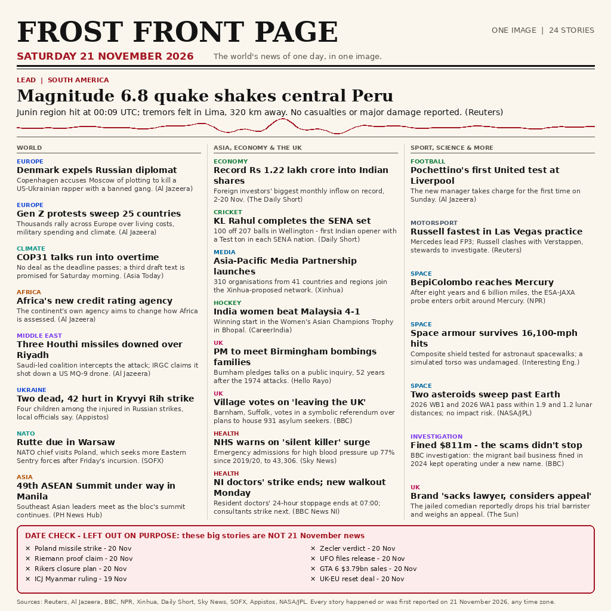

# Frost Front Page — Saturday 21 November 2026

[](https://make.fun/c/news-image-20261121)
[](https://make.fun/c/news-image-20261121)
[](https://make.fun/c/news-image-20261121)

One image summing up the world news of **Saturday 21 November 2026** — a
newspaper front page with 24 stories, every one verified as having happened
or first been reported on 21 November 2026 in some time zone.



## The 24 stories

Lead: **Magnitude 6.8 earthquake strikes central Peru** — Junín region,
00:09 UTC; felt in Lima, no casualties or major damage. (Reuters)

World
1. Denmark expels a Russian diplomat; accuses Russia of plotting to
   assassinate a US-Ukrainian rapper. (Al Jazeera)
2. Gen Z protests sweep 25 European countries over living costs, military
   spending and climate. (Al Jazeera)
3. COP31 talks run into overtime with no deal; a third draft text is
   promised for Saturday morning. (Asia Today, Al Jazeera)
4. Africa's new credit rating agency aims to change how the continent is
   assessed. (Al Jazeera)
5. Saudi-led coalition intercepts three Houthi missiles aimed at Riyadh;
   IRGC claims it downed a US MQ-9 drone over the Strait of Hormuz.
   (Al Jazeera)
6. Two dead, 42 injured (four children) in Russian strikes on Kryvyi Rih.
   (Appistos)
7. NATO chief Rutte due in Warsaw; Poland seeks more Eastern Sentry forces
   after Friday's missile incursion. (SOFX)
8. 49th ASEAN Summit under way in Manila. (PH News Hub)

Asia, economy & the UK
9. Foreign investors pour a record Rs 1.22 lakh crore into Indian shares,
   2–20 Nov — the highest monthly inflow on record. (The Daily Short)
10. KL Rahul completes the SENA set — 100 off 207 balls in Wellington, the
    first Indian opener with a Test century in each SENA nation.
    (The Daily Short)
11. Asia-Pacific Media Partnership officially launched — 310 organisations
    from 41 countries and regions. (Xinhua)
12. India women's hockey beats Malaysia 4–1 in the Women's Asian Champions
    Trophy opener in Bhopal. (CareerIndia)
13. PM to meet Birmingham bombings families seeking a public inquiry, on
    the 52nd anniversary of the attacks. (Hello Rayo)
14. Suffolk village Barnham votes in a symbolic referendum on "leaving the
    UK" over an asylum-seeker base for up to 931 people. (BBC)
15. NHS warns of an "alarming" 77% rise in high-blood-pressure emergency
    admissions since 2019/20. (Sky News / NHS England)
16. Northern Ireland resident doctors' strike ends at 07:00 GMT; consultants
    walk out on Monday. (BBC News NI)

Sport, science & more
17. Pochettino to take charge of Manchester United for the first time on
    Sunday at Liverpool. (Al Jazeera)
18. F1 Las Vegas GP: Russell fastest in FP3, Mercedes 1–2, clashes with
    Verstappen. (Reuters)
19. BepiColombo enters orbit around Mercury after an eight-year journey.
    (NPR)
20. "Space Armor" survives 16,100-mph debris hits in an
    astronaut-protection test. (Interesting Engineering)
21. Two small asteroids, 2026 WB1 and 2026 WA1, sweep past Earth — no
    impact risk. (NASA/JPL, The Watchers)
22. Fined $811m for conning detained migrants — the scams didn't stop.
    (BBC investigation)
23. Russell Brand "sacks lawyer, considers appeal" after his conviction.
    (The Scottish Sun / Daily Mail)

## Date check — deliberately left out

These big stories look like 21 November news but are not; the image's
DATE CHECK box names the biggest ones so the judge can see the dating was
checked, not guessed:

- Russian missile crashing in Poland — 20 Nov
- Claimed Riemann hypothesis proof (Anthropic mathematician) — 20 Nov
- NYC Mayor Mamdani's plan to close Rikers Island by 2032 — 20 Nov
- ICJ ruling Myanmar responsible for Rohingya genocide — 19 Nov
- French police sentenced over the Michel Zecler beating — 20 Nov
- US declassification of UFO footage — 20 Nov
- GTA 6 $3.79bn first-day sales — 20 Nov
- UK–EU reset deal agreed — 20 Nov
- Cyclone Akvan's Odisha landfall — 20 Nov
- Trump–Putin "very good talks" on Ukraine — 20 Nov

## How it works

- `draw.py` renders the front page with PIL (DejaVu fonts, deterministic
  layout, no randomness) and writes `entry.png` (1024×1024, ~200 KB).
- `main.py` is the entrypoint: standard library only, it copies
  `entry.png` to `$MAKEFUN_OUTPUT_DIR` (default `/output`) and verifies
  the copy with a SHA-256 check, so both graded runs write identical
  bytes. It creates the output directory if missing and never removes it.

### Run it locally

```sh
python3 draw.py            # rebuild entry.png from the story data
mkdir -p out
MAKEFUN_OUTPUT_DIR=out python3 main.py   # writes out/entry.png
```

Run `main.py` twice into two directories and compare the files: the
SHA-256 hashes must match exactly.

## License

MIT — see `LICENSE`.
